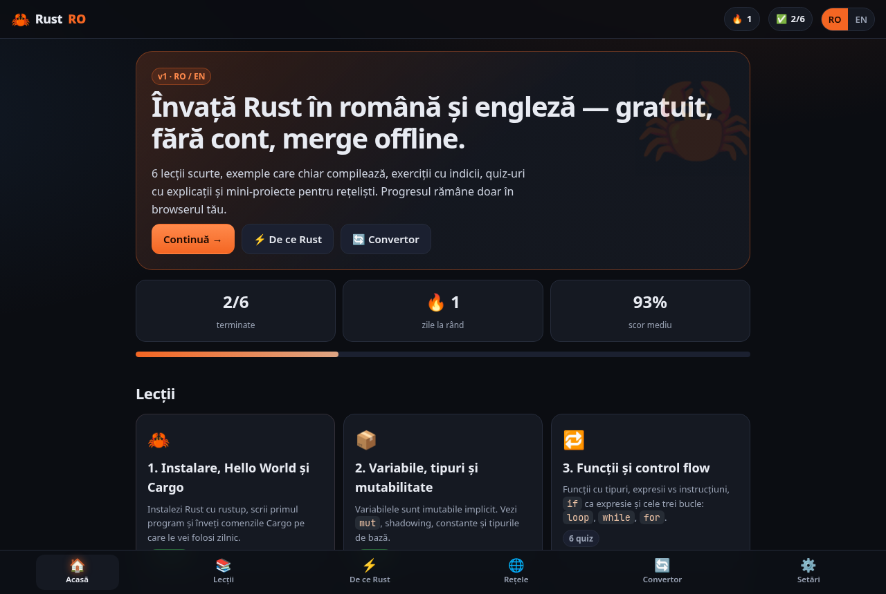
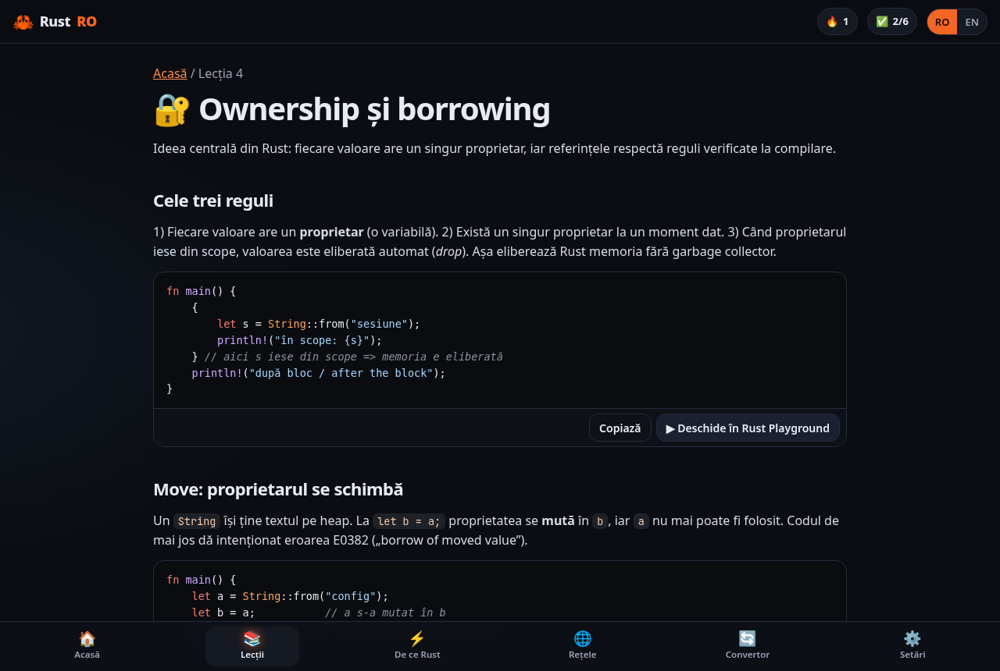
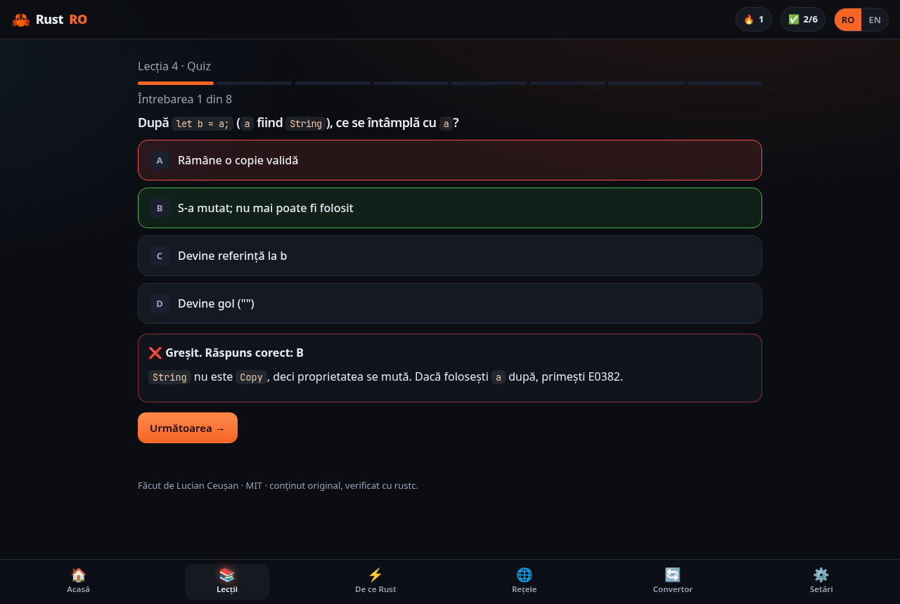
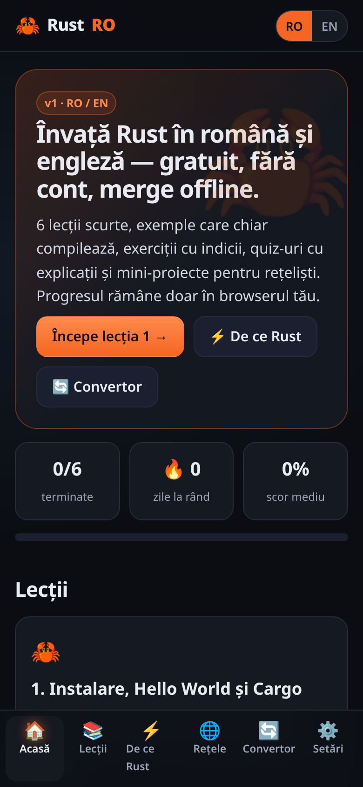
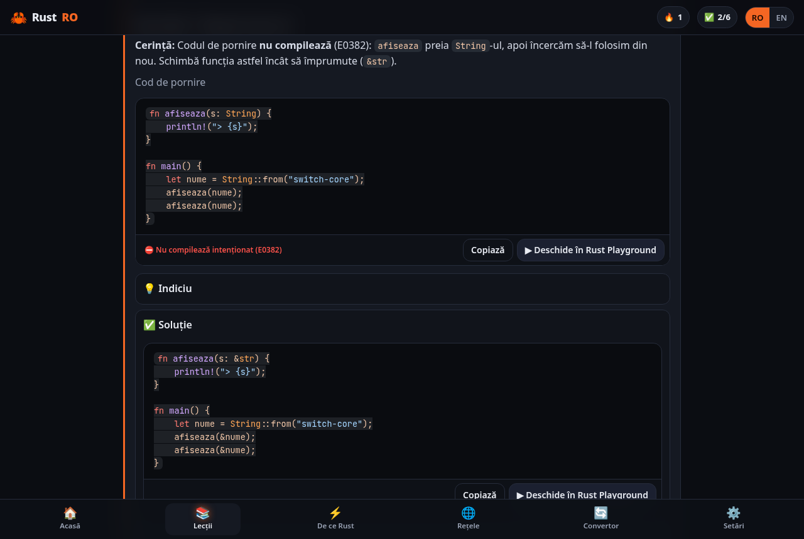
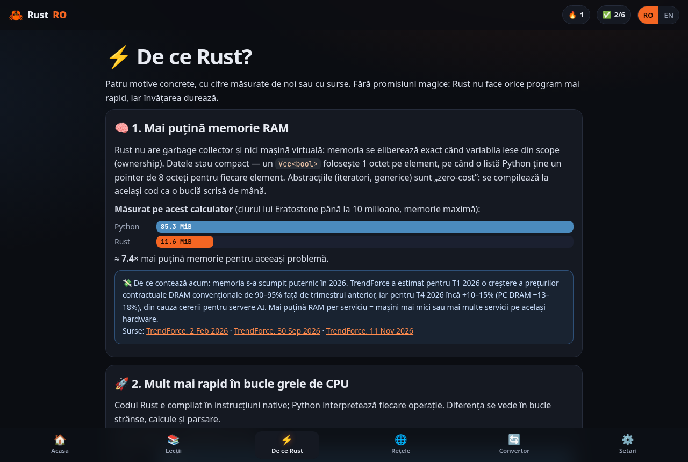
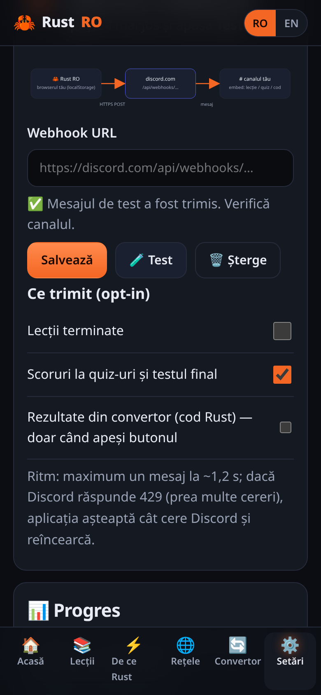
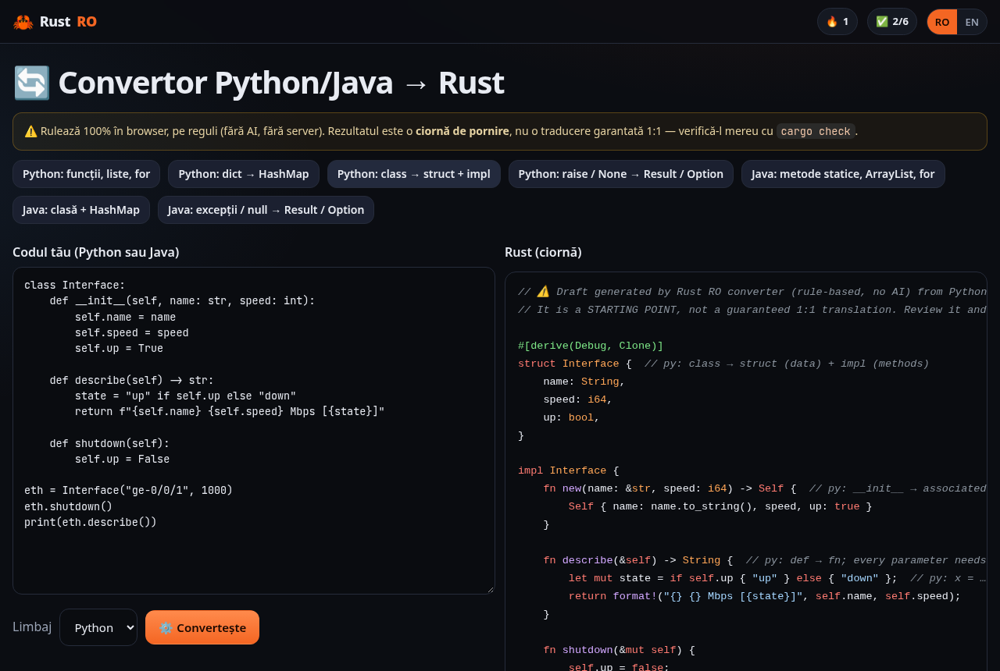
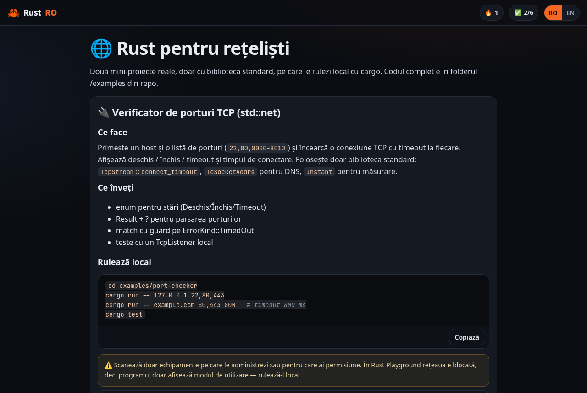
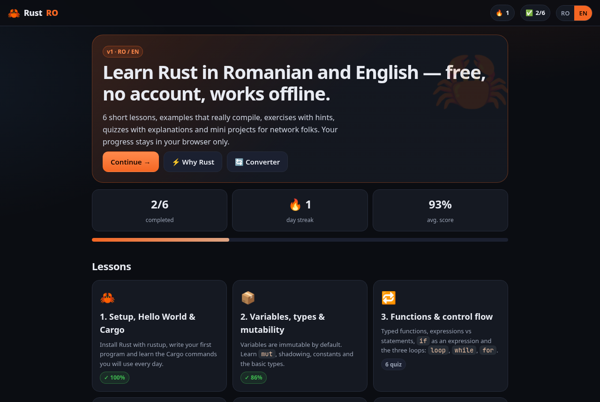

<div align="center">


# Rust RO 🦀

**Learn Rust in Romanian and English — lessons, exercises, quizzes, network mini projects and a Python/Java → Rust draft converter. Static, no account, works offline.**

<a href="LICENSE"></a>


<a href="https://github.com/LucianCeusanRo/rust-ro/stargazers"></a>
<a href="https://github.com/LucianCeusanRo/rust-ro/commits/main"></a>

[English](#-about) · [Română](#-română)

</div>

<p align="center"></p>

## 📑 Table of contents

- [📖 About](#-about)
- [✨ Features](#-features)
- [🖼️ Screenshots](#️-screenshots)
- [🧠 How it works](#-how-it-works)
- [⚡ Quick start](#-quick-start)
- [📚 Tutorial](#-tutorial)
- [⚡ Why Rust (with real numbers)](#-why-rust-with-real-numbers)
- [🔄 Python/Java → Rust converter](#-pythonjava--rust-converter)
- [💬 Discord webhook (optional)](#-discord-webhook-optional)
- [✅ Verification](#-verification)
- [🗂️ Project structure](#️-project-structure)
- [🗺️ Roadmap](#️-roadmap)
- [🤝 Contributing](#-contributing)
- [📄 License](#-license)
- [🇷🇴 Română](#-română)

## 📖 About

Rust RO is a free, bilingual (Romanian / English, one-click toggle) platform for learning Rust from zero. It follows the same idea as my STS exam trainer: short lessons, instant feedback, a score you want to improve, and everything stored only in your browser.

- **Used for:** learning Rust basics step by step — setup and Cargo, variables and types, functions and control flow, ownership and borrowing, structs/enums/match, and error handling with `Result`, `Option` and `?`.
- **Helps:** Romanian speakers who prefer to learn in their language, beginners coming from Python/Java, and network/telecom people who want small, practical Rust tools.
- All content is written from scratch (not copied from the Rust Book) and **every Rust snippet is compile-checked with `rustc`**.

## ✨ Features

- 📚 **6 lessons**, each with RO + EN explanations, highlighted code and an **Open in Rust Playground** button on every example and exercise.
- ✍️ **12 exercises** with starter code, hint and solution (also runnable in the Playground).
- 📝 **41 quiz questions** with explanations (5–8 per lesson), plus a **final test** of 15 shuffled questions (70% pass mark).
- ⛔ Intentionally broken examples (E0382, E0384, E0499) so you learn to read compiler errors — the checker verifies they fail with *exactly* that error.
- 🌐 **Rust for network folks**: a TCP port checker (`std::net`) and a network log parser, runnable locally with `cargo`, with unit tests.
- ⚡ **Why Rust** page with numbers measured on a real machine (time + peak RAM vs Python) and cited sources.
- 🔄 **Python/Java → Rust converter**: rule-based, 100% in the browser, no AI, explains each mapping in comments.
- 💬 **Optional Discord webhook**: post lesson completions, quiz scores and converter output to *your own* channel.
- 🔥 Progress, best scores and a daily **streak** in `localStorage` — no account, no backend, no tracking.
- 📱 Mobile-first dark UI, installable **PWA**, works offline; keyboard and screen-reader friendly (skip link, focus management, `aria-live` quiz feedback, reduced-motion support).

## 🖼️ Screenshots

| Lesson | Quiz feedback | Mobile |
|---|---|---|
|  |  |  |
| **Exercise (hint + solution)** | **Why Rust (measured)** | **Discord settings** |
|  |  |  |
| **Converter** | **Network projects** | **English UI** |
|  |  |  |

All screenshots are real, taken with Playwright (`python3 tools/screenshots.py`).

## 🧠 How it works

```
content/*.js ──► window.RUST_LESSONS ──► assets/app.js (hash router) ──► lesson / quiz / final / why / net / convert / settings
     │                                          │
     │                                          ├─► localStorage "rustro.progress.v1"  (done, best scores, streak, language)
     │                                          ├─► localStorage "rustro.discord.v1"   (your webhook + opt-ins, optional)
     │                                          └─► sw.js (offline cache, same-origin only)
     └─► tools/check-snippets.mjs ──► rustc on every snippet (must compile / must fail with the declared error)

examples/ + bench/ ──► tools/gen-content.mjs ──► content/07-net.js, content/08-why.js   (single source of truth)
```

- **No build step, no framework, no dependencies.** Plain HTML/CSS/JS; open it from any static host.
- **Lessons are data.** Each lesson is a JS object with `{ ro, en }` texts, `code`, `exercises` and `quiz`.
- **Playground links** are `https://play.rust-lang.org/?version=stable&mode=debug&edition=2021&code=` + `encodeURIComponent(code)`.
- **Streak** = consecutive days on which you finished at least one quiz.

## ⚡ Quick start

```bash
git clone https://github.com/LucianCeusanRo/rust-ro.git
cd rust-ro
python3 -m http.server 8811     # or: npx serve .
# open http://localhost:8811
```

Run the network mini projects (needs Rust from https://rustup.rs):

```bash
cd examples/port-checker && cargo run -- 127.0.0.1 22,80,443 && cargo test
cd ../log-parser && cargo run -- sample.log --level ERROR && cargo test
```

Run every check:

```bash
npm test          # converter tests + Discord tests (mocked fetch) + rustc check of all 50 snippets
npm run bench     # re-measure Python vs Rust and regenerate the Why Rust page
```

## 📚 Tutorial

1. **Pick your language** with the `RO | EN` toggle (top right). It's remembered.
2. **Open lesson 1** from the home screen. Read a section, then press **▶ Open in Rust Playground** to run the example without installing anything.
3. **Do the exercises:** start from the starter code, open 💡 *Hint* if you're stuck, compare with ✅ *Solution*.
4. **Take the quiz.** Every answer shows an explanation. 70% or more marks the lesson as completed and counts towards your 🔥 streak.
5. **Install Rust locally** (lesson 1 shows how) and run the 🌐 network projects with `cargo run`.
6. **Finish with the 🏁 final test** — 15 random questions from all lessons.
7. Optional: paste your Python/Java code into 🔄 *Converter* to get a commented Rust draft, then fix it with `cargo check`.

## ⚡ Why Rust (with real numbers)

Measured on this project's build machine with `python3 bench/run.py` (median of 3 runs; peak RSS = max `VmHWM` from `/proc/<pid>/status`; Python 3.13.5, rustc 1.99.1, `-C opt-level=3`, Intel Xeon). Same algorithm, same output:

| Benchmark | Python time | Rust time | Python peak RAM | Rust peak RAM |
|---|---|---|---|---|
| Sieve of Eratosthenes, N = 10,000,000 | 1.367 s | 0.040 s | 85.3 MiB | 11.6 MiB |
| Longest Collatz chain below 1,000,000 | 7.245 s | 0.141 s | 9.1 MiB | 2.1 MiB |

Honest limits: this is pure Python without NumPy; with NumPy/C extensions the gap shrinks a lot, and I/O-bound programs gain little. Source code: [`bench/`](bench). Raw data: [`bench/results.json`](bench/results.json).

Why RAM matters right now: TrendForce estimated conventional DRAM contract prices up 90–95% QoQ in 1Q26 ([2 Feb 2026](https://www.trendforce.com/presscenter/news/20260202-12911.html)) and another +10–15% for 4Q26, PC DRAM +13–18% ([30 Sep 2026](https://www.trendforce.com/presscenter/news/20260930-13258.html), [11 Nov 2026](https://www.trendforce.com/presscenter/news/20261111-13303.html)). On memory safety, the Chromium team reports that ~70% of its serious security bugs are memory-safety problems ([chromium.org](https://www.chromium.org/Home/chromium-security/memory-safety/)). Broader cross-language data: [The Benchmarks Game](https://benchmarksgame-team.pages.debian.net/benchmarksgame/index.html).

## 🔄 Python/Java → Rust converter

[`assets/converter.js`](assets/converter.js) is a rule/pattern-based translator (no AI, no server, no local model). It handles functions and typed parameters, variables (`let mut`), `if/elif/else`, `for`/`range`/`enumerate`, `while`/`while True`, lists → `Vec`, dict/`Map` → `HashMap` (including the `d[k] += 1` → `entry()` idiom), classes → `struct` + `impl` + `new()`, `print`/`System.out.println` → `println!` (f-strings and `+` concatenation become format strings), `raise`/`throw` → `Result<T, String>` + `Err`, `None`/`null` → `Option`, `and/or/not` → `&&/||/!`, and camelCase → snake_case for Java methods.

Each first use of a mapping gets an explanatory comment, unsupported things produce warnings, and **every output starts with a "draft — review it" header**. Not translated: inheritance, interfaces, complex lambdas, generators, decorators, async, external libraries; `try/except` bodies are kept as comments. The 7 bundled examples are converted in [`tests/converter.test.mjs`](tests/converter.test.mjs) and **all 7 compile with rustc and print the expected output**; your own code may need fixes.

## 💬 Discord webhook (optional)

Settings → *Discord webhook*:

1. In Discord: **Server Settings → Integrations → Webhooks → New Webhook**, pick a channel.
2. **Copy Webhook URL**, paste it in Rust RO and press **Save**.
3. Press **Test** — one test embed is sent to that webhook, only when you click. Then opt in to *lesson completions*, *quiz scores* and/or *converter results* (sent only when you press the button on the converter page).

Privacy and safety: the URL is validated (`https://discord.com/api/webhooks/<id>/<token>`, also `canary.`/`ptb.`/`discordapp.com`), stored **only in your browser's localStorage**, shown masked, never logged and never part of this repo. Requests go straight from your browser to discord.com with `allowed_mentions: { parse: [] }` (no pings). Rate limits: one post at a time, ≥1.2 s apart, `X-RateLimit-Remaining`/`Reset-After` honoured, and on HTTP 429 the client waits `retry_after` and retries (max 3 attempts). Tests use a **mocked fetch only** ([`tests/discord.test.mjs`](tests/discord.test.mjs)); the Playwright run intercepts every discord.com request locally.

## ✅ Verification

| Check | Result |
|---|---|
| `node tools/check-snippets.mjs` — every lesson example, starter, solution, network project and benchmark through `rustc` (edition 2021) | **50/50 OK** (46 compile — 31 of them also run without panicking; 4 fail on purpose with E0384, E0382, E0499, E0382) — [`docs/snippet-check.txt`](docs/snippet-check.txt) |
| `cargo test` + `cargo clippy --all-targets -- -D warnings` in `examples/*` | 3 + 3 tests pass, clippy clean |
| `node tests/converter.test.mjs` | 31/31, 7/7 converted examples compile — [`docs/converter-test.txt`](docs/converter-test.txt) |
| `node tests/discord.test.mjs` (mocked fetch) | 15/15 — [`docs/discord-test.txt`](docs/discord-test.txt) |
| `python3 tools/screenshots.py` (Playwright smoke test) | no page errors |

## 🗂️ Project structure

```
index.html, manifest.webmanifest, sw.js   static app shell + PWA
assets/      app.js (router/UI), app.css, i18n.js, highlight.js, converter.js, converter-examples.js, discord.js, icons
content/     00-init.js … 06-errors.js (lessons), 07-net.js + 08-why.js (generated)
examples/    port-checker/, log-parser/  (cargo projects with tests)
bench/       sieve + collatz in Python and Rust, run.py, results.json
tests/       converter.test.mjs, discord.test.mjs
tools/       check-snippets.mjs, gen-content.mjs, screenshots.py
docs/        screenshots/ + test reports
```

## 🗺️ Roadmap

- [ ] Lessons 7–12: collections (`Vec`, `HashMap`, iterators), traits & generics, lifetimes, modules & crates, tests, threads/async (tokio)
- [ ] More network projects: async ping monitor, SNMP poller, syslog receiver
- [ ] In-page run via the Playground API, with output shown under the example
- [ ] Converter: list comprehensions → iterators everywhere, Python `with open()` → `std::fs`, Java interfaces → traits
- [ ] Spaced-repetition review of wrong answers

## 🤝 Contributing

Issues and pull requests are welcome — typos in RO/EN, clearer explanations, new quiz questions. Please run `npm test` before opening a PR: every new snippet must pass `tools/check-snippets.mjs`.

## 📄 License

[MIT](LICENSE) © 2026 Lucian Ceușan

---

## 🇷🇴 Română

### 📖 Despre

Rust RO este o platformă gratuită, bilingvă (română / engleză, comutare dintr-un click), pentru a învăța Rust de la zero. Pornește de la aceeași idee ca aplicația mea STS Grilă: lecții scurte, feedback imediat, un scor pe care vrei să-l crești și totul salvat doar în browserul tău.

- **La ce folosește:** înveți pas cu pas bazele Rust — instalare și Cargo, variabile și tipuri, funcții și control flow, ownership și borrowing, structuri/enum-uri/match și tratarea erorilor cu `Result`, `Option` și `?`.
- **Pe cine ajută:** pe cei care preferă să învețe în română, începătorii care vin din Python/Java și oamenii din rețelistică/telecom care vor unelte Rust mici și practice.
- Tot conținutul e scris de la zero (nu e copiat din Rust Book), iar **fiecare exemplu Rust este verificat cu `rustc`**.

### ✨ Funcționalități

- 📚 **6 lecții** cu explicații RO + EN, cod colorat și buton **Deschide în Rust Playground** la fiecare exemplu și exercițiu.
- ✍️ **12 exerciții** cu cod de pornire, indiciu și soluție.
- 📝 **41 de întrebări** cu explicații + **test final** de 15 întrebări amestecate (prag 70%).
- ⛔ Exemple care **nu compilează intenționat** (E0382, E0384, E0499), ca să înveți să citești erorile compilatorului.
- 🌐 **Rust pentru rețeliști**: verificator de porturi TCP (`std::net`) și parser de loguri, rulate local cu `cargo`, cu teste.
- ⚡ Pagina **De ce Rust**, cu cifre măsurate real (timp + RAM față de Python) și surse citate.
- 🔄 **Convertor Python/Java → Rust**: pe reguli, 100% în browser, fără AI, cu explicații în comentarii.
- 💬 **Webhook Discord opțional**: trimite lecțiile terminate, scorurile și codul convertit pe canalul **tău**.
- 🔥 Progres, cele mai bune scoruri și **zile la rând** în `localStorage` — fără cont, fără server, fără tracking.
- 📱 Interfață dark, mobile-first, instalabilă (PWA), merge offline, accesibilă de la tastatură și cu cititor de ecran.

### ⚡ Pornire rapidă

```bash
git clone https://github.com/LucianCeusanRo/rust-ro.git
cd rust-ro
python3 -m http.server 8811
# deschide http://localhost:8811
```

Proiectele de rețea (ai nevoie de Rust de pe https://rustup.rs):

```bash
cd examples/port-checker && cargo run -- 127.0.0.1 22,80,443
cd ../log-parser && cargo run -- sample.log --level ERROR
```

### 📚 Tutorial pas cu pas

1. **Alege limba** din comutatorul `RO | EN` (dreapta sus). Rămâne salvată.
2. **Deschide lecția 1.** Citești o secțiune și apeși **▶ Deschide în Rust Playground** ca să rulezi exemplul fără să instalezi nimic.
3. **Rezolvă exercițiile:** pornești de la codul dat, deschizi 💡 *Indiciu* dacă te blochezi și compari cu ✅ *Soluție*.
4. **Fă quiz-ul.** Fiecare răspuns are explicație. Cu 70% sau mai mult lecția e marcată ca terminată și îți crește 🔥 seria de zile.
5. **Instalează Rust local** (lecția 1 arată cum) și rulează 🌐 proiectele de rețea cu `cargo run`.
6. **Termină cu 🏁 testul final** — 15 întrebări din toate lecțiile.
7. Opțional: lipește cod Python/Java în 🔄 *Convertor* ca să primești o ciornă Rust comentată, apoi o repari cu `cargo check`.

### ⚡ De ce Rust (cu cifre reale)

Pe aceeași mașină, același algoritm și același rezultat: ciurul până la 10 milioane a durat **1,367 s în Python vs 0,040 s în Rust** și a folosit **85,3 MiB vs 11,6 MiB** RAM; lanțul Collatz sub 1 milion **7,245 s vs 0,141 s**. E Python pur, fără NumPy — cu NumPy diferența scade, iar programele care așteaptă după rețea/disc câștigă puțin. RAM-ul contează acum pentru că s-a scumpit mult în 2026 (surse TrendForce în secțiunea engleză și în aplicație).

### 🔄 Convertorul

Transformă construcțiile uzuale (funcții, variabile, if/for/while, liste → `Vec`, dict/Map → `HashMap`, clase → `struct` + `impl`, print → `println!`, excepții → `Result`, None/null → `Option`) și explică fiecare transformare în comentarii. **Rezultatul este o ciornă de pornire, nu o traducere garantată 1:1.** Moștenirea, interfețele, lambda-urile complexe, async și bibliotecile externe nu sunt traduse. Cele 7 exemple incluse compilează toate cu rustc.

### 💬 Discord (opțional)

1. În Discord: **Setările serverului → Integrări → Webhooks → Webhook nou**, alegi canalul.
2. **Copiezi URL-ul webhook-ului**, îl lipești în Rust RO → **Salvează**.
3. Apeși **Test** (trimite un singur mesaj de test, doar când apeși), apoi bifezi ce vrei să fie trimis.

URL-ul e validat, salvat **doar în browserul tău**, afișat mascat, nu e scris în loguri și nu e în repo. Aplicația respectă limitele Discord (un mesaj la ~1,2 s, așteaptă la 429). Testele folosesc doar un `fetch` simulat.

### 🗺️ Planuri

- [ ] Lecțiile 7–12: colecții și iteratori, trait-uri și generice, lifetimes, module și crate-uri, teste, fire de execuție/async
- [ ] Mai multe proiecte de rețea: monitor de ping async, poller SNMP, receptor syslog
- [ ] Rulare direct în pagină prin API-ul Playground

### 👤 Autor

**Lucian Ceușan** — telecom & network technician, București, România · [GitHub](https://github.com/LucianCeusanRo) · [lucian-ceusan.vercel.app](https://lucian-ceusan.vercel.app)
