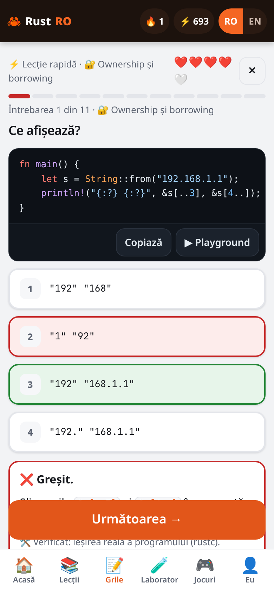
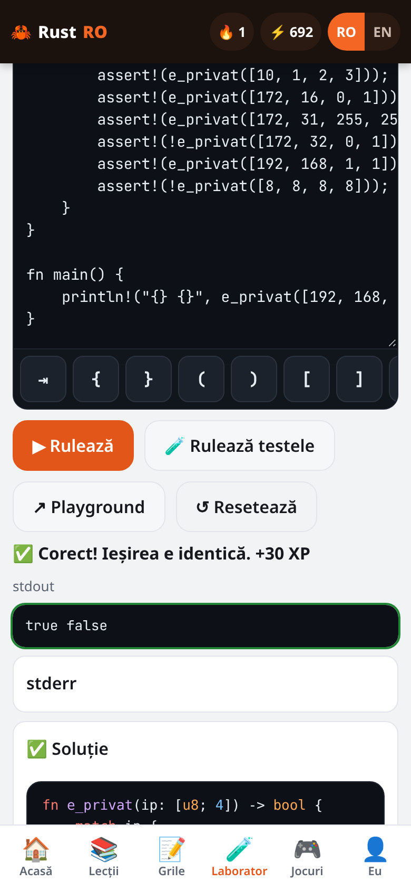
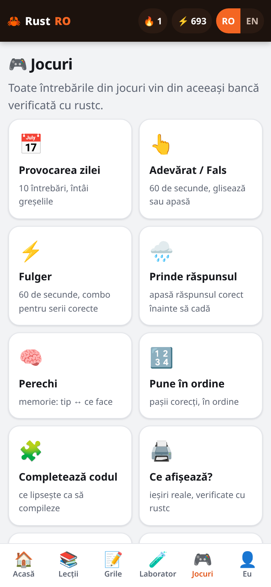
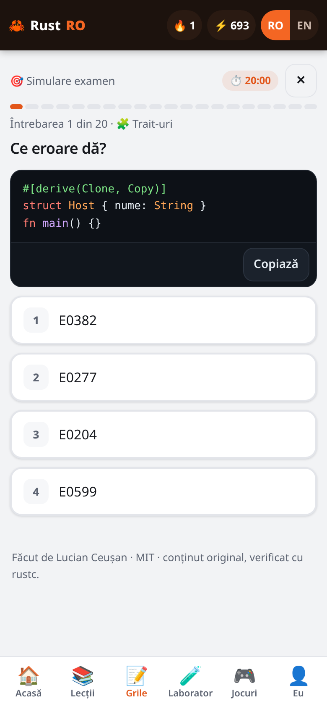
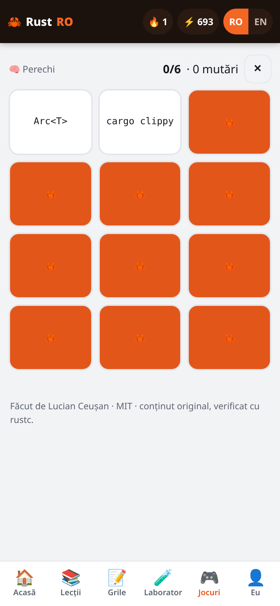
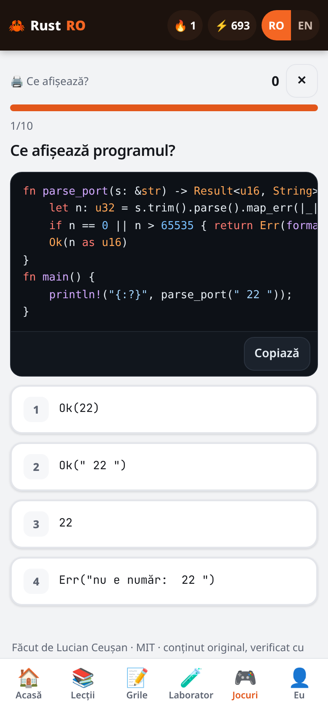
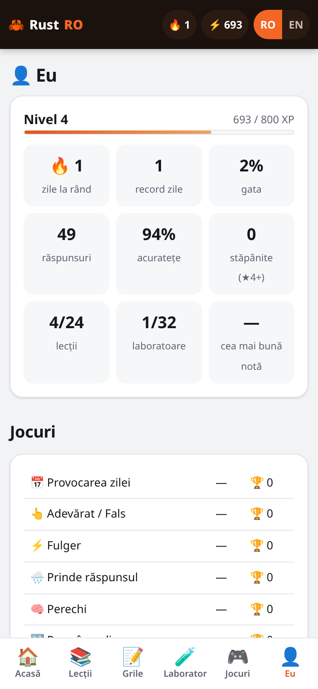
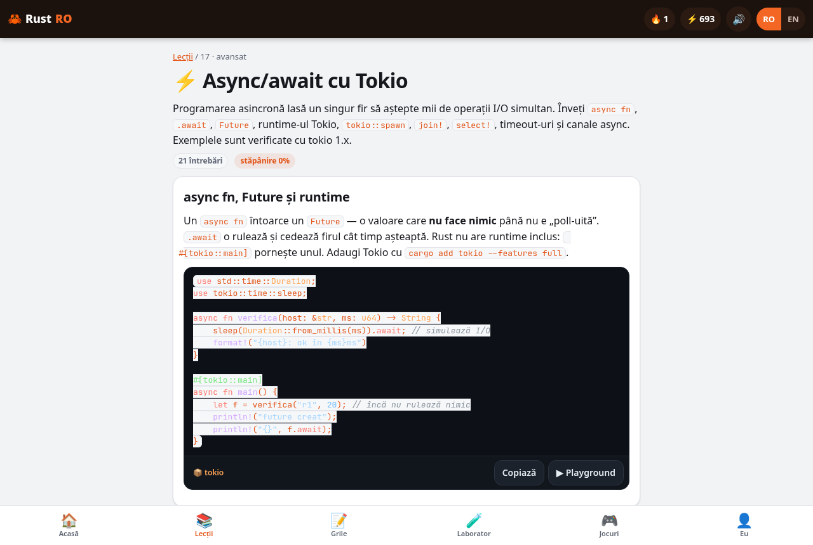
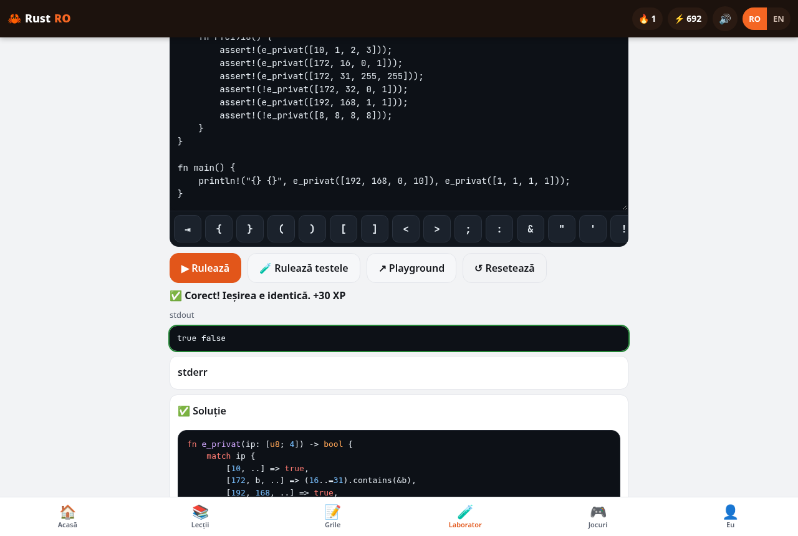
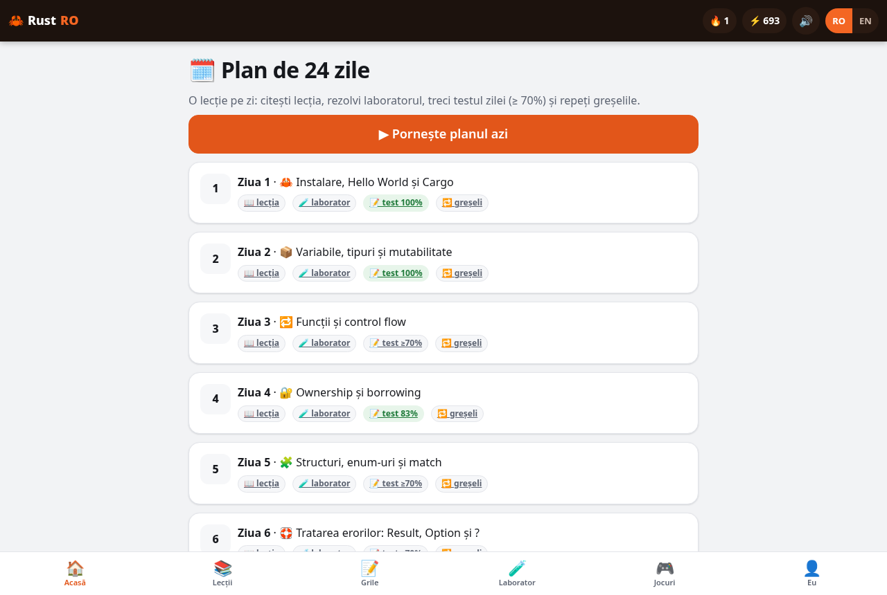

<div align="center">


# Rust RO 🦀

**▶ Live: [rust-ro.vercel.app](https://rust-ro.vercel.app)**

**Learn Rust in Romanian and English — 24 lessons, 533 quiz questions, 32 coding labs and 10 games, beginner to advanced. Static PWA, no account, works offline.**

<a href="LICENSE"></a>
<a href="https://github.com/LucianCeusanRo/rust-ro/actions/workflows/ci.yml"></a>


[English](#-about) · [Română](#-română)

</div>

<p align="center"></p>

## 📖 About

Rust RO is a free, bilingual (RO/EN, one-tap toggle) Rust trainer built like my **STS Grilă** exam app: a readiness ring, "review my mistakes", exam simulation with a 1–10 grade, several quiz modes, a day-by-day plan and mini games — all stored only in your browser. Content is written from scratch and **every piece of code is compiled with `rustc`/`cargo`** before it ships.

## ✨ Features

| Area | What you get |
|---|---|
| 📚 Lessons | **24** lessons, RO + EN, beginner → expert (table below), highlighted code, intentionally broken examples with the exact compiler error |
| 📝 Question bank | **533** questions (22 ± 3 per lesson). **258 are code questions verified by the compiler**: 197 "what does it print" (real stdout), 56 "which error" (exact `E0xxx`), 5 compile/test-pass |
| 🎯 Quiz modes (as in STS Grilă) | 📘 Learn (wrong answers come back) · ✏️ Exercise · 📈 Adaptive (weakest first) · 🏃 Marathon (3 lives) · ⚡ Quick lesson (5 hearts) · lesson quiz (≥ 70% completes a lesson) · ❌ My mistakes (spaced review: right twice and it's gone) · 🎯 **Exam simulation** (20 questions, 20 min, grade = 1 + 9 × correct/20) |
| 🎮 10 games | 📅 Daily challenge · 👆 True/False swipe (60 s) · ⚡ Lightning (60 s, combo) · 🌧️ Catch the falling answer · 🧠 Memory pairs · 🔢 Put in order · 🧩 Complete the code · 🖨️ What does it print? · 🛑 Which error? · 🏷️ What's the type? |
| 🧪 Labs | **32** labs with an in-page, phone-friendly editor (quick-key bar for `{ } ( ) ; & : < > " ! ?`, Tab, Ctrl+Enter), **Run** via the official Rust Playground API (`play.rust-lang.org/execute`), automatic check against the expected output, "Run tests" for test labs. axum/wasm-bindgen labs (crates the Playground doesn't have) show the expected output and run locally |
| 📈 Progress | mastery 0–5 per question, XP + levels, 🔥 streak, readiness ring (theory / labs / games), weak areas, per-lesson mastery, exam history, 24-day plan, export/import JSON |
| ⚡ Extra | Why Rust (measured numbers + sources), Python/Java → Rust draft converter, network mini projects, optional Discord webhook |
| 📱 Mobile-first | ≥ 44 px tap targets, bottom nav, light/dark theme, installable PWA with offline cache, keyboard shortcuts (1–4, Enter), reduced-motion support |

### Lessons

| # | Lesson / Lecție | Level |
|---|---|---|
| 1 | Setup, Hello World & Cargo | beginner |
| 2 | Variables, types & mutability | beginner |
| 3 | Functions & control flow | beginner |
| 4 | Ownership & borrowing | beginner |
| 5 | Structs, enums & match | beginner |
| 6 | Error handling: Result, Option & ? | beginner |
| 7 | Collections: Vec, String, HashMap | intermediate |
| 8 | Generics | intermediate |
| 9 | Traits | intermediate |
| 10 | Lifetimes | intermediate |
| 11 | Closures | intermediate |
| 12 | Iterators | intermediate |
| 13 | Modules, crates & Cargo | intermediate |
| 14 | Testing | intermediate |
| 15 | Smart pointers: Box, Rc, RefCell | advanced |
| 16 | Concurrency: threads, channels, Arc<Mutex> | advanced |
| 17 | Async/await with Tokio | advanced |
| 18 | Networking with std::net | advanced |
| 19 | Command-line tools (clap) | advanced |
| 20 | Web with axum 0.8 | expert |
| 21 | Unsafe Rust basics | expert |
| 22 | FFI: Rust and C | expert |
| 23 | WebAssembly (wasm-bindgen) | expert |
| 24 | Embedded intro (no_std) | expert |

## 🖼️ Screenshots

Real screenshots from Playwright (`python3 tools/screenshots.py`).

| Home (mobile) | Quiz feedback | Lab editor | Games |
|---|---|---|---|
|  |  |  |  |
| **Exam** | **Memory pairs** | **What does it print?** | **Me / stats** |
|  |  |  |  |

| Lesson (desktop) | Lab (desktop) | 24-day plan |
|---|---|---|
|  |  |  |

## ⚡ Quick start

```bash
git clone https://github.com/LucianCeusanRo/rust-ro.git
cd rust-ro
python3 -m http.server 8811     # open http://localhost:8811
```

## ✅ Verification

| Check | Result |
|---|---|
| `node tools/check-snippets.mjs` — every lesson example, lab starter + solution (output must match), every code question (stdout must equal the correct option in RO and EN; no wrong option may equal it; error questions must fail with exactly that code), every game item (fill-in: right option prints the expected output, every wrong option fails or prints something else; types: right type compiles, every wrong type fails). Crate snippets (tokio, clap, axum 0.8, wasm-bindgen, serde) are built with cargo | **575/575 OK** with rustc 1.99.1 — [`docs/snippet-check.txt`](docs/snippet-check.txt) |
| `python3 tests/ui.test.py` (Playwright, Discord + Playground mocked) — lesson quiz → lesson done, mistakes review, exam grade, marathon lives, lab run, 9 game screens, EN UI, no Discord calls without a webhook, no JS errors | 21/21 |
| `python3 tests/ui.test.py --live-playground` | lab solution and its tests pass on the real Rust Playground |
| `node tests/converter.test.mjs` / `node tests/discord.test.mjs` (mocked fetch) | 31/31 · 15/15 |
| GitHub Actions [`ci.yml`](.github/workflows/ci.yml) | runs all of the above on every push |

## 🧠 How it works

```
content/NN-*.js ─► window.RUST_LESSONS + QB(cat, [...]) ─► window.RUST_BANK ─► assets/app.js (hash router)
content/30-games.js ─► window.RUST_GAMES (pairs, order, fill, types)          ├─ localStorage "rustro.progress.v1" (progress, mastery, XP, labs, plan)
tools/check-snippets.mjs ─► rustc / cargo on everything above                 ├─ play.rust-lang.org/execute (labs, only when you press Run)
tools/build-dist.mjs ─► dist/ (single inlined index.html + sw.js) ─► Vercel  └─ sw.js offline cache (same-origin only)
```

Question authoring format: `[question, [correct, wrong…], explanation, { k: "out" | "err" | "ok" | "test", c: code, err: "E0xxx", crate }]`, texts as `"RO || EN"`. The correct option is stored first and shuffled on screen.

## ⚡ Why Rust (with real numbers)

Measured on this project's build machine with `python3 bench/run.py` (median of 3 runs; peak RSS = max `VmHWM` from `/proc/<pid>/status`; Python 3.13.5, rustc 1.99.1, `-C opt-level=3`, Intel Xeon). Same algorithm, same output:

| Benchmark | Python time | Rust time | Python peak RAM | Rust peak RAM |
|---|---|---|---|---|
| Sieve of Eratosthenes, N = 10,000,000 | 1.367 s | 0.040 s | 85.3 MiB | 11.6 MiB |
| Longest Collatz chain below 1,000,000 | 7.245 s | 0.141 s | 9.1 MiB | 2.1 MiB |

Honest limits: this is pure Python without NumPy; with NumPy/C extensions the gap shrinks a lot, and I/O-bound programs gain little. Source code: [`bench/`](bench). Raw data: [`bench/results.json`](bench/results.json).

Why RAM matters right now: TrendForce estimated conventional DRAM contract prices up 90–95% QoQ in 1Q26 ([2 Feb 2026](https://www.trendforce.com/presscenter/news/20260202-12911.html)) and another +10–15% for 4Q26, PC DRAM +13–18% ([30 Sep 2026](https://www.trendforce.com/presscenter/news/20260930-13258.html), [11 Nov 2026](https://www.trendforce.com/presscenter/news/20261111-13303.html)). On memory safety, the Chromium team reports that ~70% of its serious security bugs are memory-safety problems ([chromium.org](https://www.chromium.org/Home/chromium-security/memory-safety/)). Broader cross-language data: [The Benchmarks Game](https://benchmarksgame-team.pages.debian.net/benchmarksgame/index.html).

## 🔄 Python/Java → Rust converter

[`assets/converter.js`](assets/converter.js) is a rule/pattern-based translator (no AI, no server, no local model). It handles functions and typed parameters, variables (`let mut`), `if/elif/else`, `for`/`range`/`enumerate`, `while`/`while True`, lists → `Vec`, dict/`Map` → `HashMap` (including the `d[k] += 1` → `entry()` idiom), classes → `struct` + `impl` + `new()`, `print`/`System.out.println` → `println!` (f-strings and `+` concatenation become format strings), `raise`/`throw` → `Result<T, String>` + `Err`, `None`/`null` → `Option`, `and/or/not` → `&&/||/!`, and camelCase → snake_case for Java methods.

Each first use of a mapping gets an explanatory comment, unsupported things produce warnings, and **every output starts with a "draft — review it" header**. Not translated: inheritance, interfaces, complex lambdas, generators, decorators, async, external libraries; `try/except` bodies are kept as comments. The 7 bundled examples are converted in [`tests/converter.test.mjs`](tests/converter.test.mjs) and **all 7 compile with rustc and print the expected output**; your own code may need fixes.

## 💬 Discord webhook (optional)

Settings → *Discord webhook*:

1. In Discord: **Server Settings → Integrations → Webhooks → New Webhook**, pick a channel.
2. **Copy Webhook URL**, paste it in Rust RO and press **Save**.
3. Press **Test** — one test embed is sent to that webhook, only when you click. Then opt in to *lesson completions*, *quiz scores* and/or *converter results* (sent only when you press the button on the converter page).

Privacy and safety: the URL is validated (`https://discord.com/api/webhooks/<id>/<token>`, also `canary.`/`ptb.`/`discordapp.com`), stored **only in your browser's localStorage**, shown masked, never logged and never part of this repo. Requests go straight from your browser to discord.com with `allowed_mentions: { parse: [] }` (no pings). Rate limits: one post at a time, ≥1.2 s apart, `X-RateLimit-Remaining`/`Reset-After` honoured, and on HTTP 429 the client waits `retry_after` and retries (max 3 attempts). Tests use a **mocked fetch only** ([`tests/discord.test.mjs`](tests/discord.test.mjs)); the Playwright run intercepts every discord.com request locally.

## 🔄 Python/Java → Rust converter

[`assets/converter.js`](assets/converter.js) is rule-based (no AI, no server). Output always starts with a "draft — review it" header; the 7 bundled examples compile with rustc. Not translated: inheritance, interfaces, complex lambdas, generators, async, external libraries.

## 💬 Discord webhook (optional)

Settings → Discord: paste **your own** webhook URL (validated as `https://discord.com/api/webhooks/<id>/<token>`), stored **only in your browser**, shown masked, never logged, never in this repo. Opt in to lesson completions / quiz and exam scores / converter output. One post at a time, ≥ 1.2 s apart, HTTP 429 `retry_after` honoured. Tests use a mocked fetch only.

## 🗂️ Project structure

```
index.html, manifest.webmanifest, sw.js   app shell + PWA
assets/      app.js (UI, quiz engine, games, labs), app.css, i18n.js, highlight.js, converter*.js, discord.js, icons
content/     00-init.js, 01–06 + 10–27 lessons, 09-basics-bank.js, 30-games.js, 99-bank-merge.js, 07-net.js + 08-why.js (generated)
tools/       check-snippets.mjs, verify-crates/ (cargo project for crate snippets), build-dist.mjs, screenshots.py
tests/       ui.test.py, converter.test.mjs, discord.test.mjs
examples/    port-checker/, log-parser/   ·   bench/   ·   docs/ (screenshots + reports)
```

## 🚀 Deploy

`npm run build` writes `dist/` (one self-contained `index.html` + `sw.js`, manifest, icons), deployed to Vercel (Hobby, free). Any static host works with the source tree as-is.

## 🤝 Contributing

PRs welcome (RO/EN wording, new questions). Run `npm test` — every new snippet or code question must pass `tools/check-snippets.mjs`.

## 📄 License

[MIT](LICENSE) © 2026 Lucian Ceușan

---

## 🇷🇴 Română

### 📖 Despre

Rust RO e o platformă gratuită, bilingvă, construită ca aplicația mea **STS Grilă**: inel „gata pentru Rust”, „Repetă greșelile”, simulare de examen cu notă 1–10, mai multe moduri de grile, plan pe zile și jocuri — totul salvat doar în browserul tău. Conținutul e scris de la zero și **tot codul e compilat cu `rustc`/`cargo`** înainte de publicare.

### ✨ Ce conține

- 📚 **24 de lecții** RO + EN, de la instalare până la async/Tokio, rețelistică cu `std::net`, unelte CLI cu clap, web cu axum, unsafe, FFI, WASM și embedded.
- 📝 **533 de întrebări**; **258 sunt întrebări de cod verificate de compilator** (ieșirea reală a programului sau codul exact de eroare).
- 🎯 Moduri: Învățare, Exercițiu, Adaptiv, Maraton (3 vieți), Lecție rapidă (5 inimi), quiz de lecție (≥ 70%), Greșelile mele (repetare spațiată), **Simulare examen** (20 de întrebări, 20 de minute, nota = 1 + 9 × corecte/20).
- 🎮 **10 jocuri**: provocarea zilei, adevărat/fals, fulger, prinde răspunsul, perechi, pune în ordine, completează codul, ce afișează, ce eroare, ce tip are.
- 🧪 **32 de laboratoare** cu editor în pagină, potrivit pe telefon (bară cu taste rapide), rulare prin API-ul oficial Rust Playground și verificare automată a ieșirii.
- 📈 Stăpânire 0–5 pe întrebare, XP și niveluri, 🔥 zile la rând, plan de 24 de zile, statistici, export/import JSON.
- 📱 Mobile-first, temă luminoasă/întunecată, PWA instalabilă, merge offline.

### ⚡ Pornire rapidă

```bash
git clone https://github.com/LucianCeusanRo/rust-ro.git
cd rust-ro && python3 -m http.server 8811   # deschide http://localhost:8811
```

### ⚡ De ce Rust (cu cifre reale)

Pe aceeași mașină, același algoritm și același rezultat: ciurul până la 10 milioane a durat **1,367 s în Python vs 0,040 s în Rust** și a folosit **85,3 MiB vs 11,6 MiB** RAM; lanțul Collatz sub 1 milion **7,245 s vs 0,141 s**. E Python pur, fără NumPy — cu NumPy diferența scade, iar programele care așteaptă după rețea/disc câștigă puțin. RAM-ul contează acum pentru că s-a scumpit mult în 2026 (surse TrendForce în secțiunea engleză și în aplicație).

### 🔄 Convertorul

Transformă construcțiile uzuale (funcții, variabile, if/for/while, liste → `Vec`, dict/Map → `HashMap`, clase → `struct` + `impl`, print → `println!`, excepții → `Result`, None/null → `Option`) și explică fiecare transformare în comentarii. **Rezultatul este o ciornă de pornire, nu o traducere garantată 1:1.** Moștenirea, interfețele, lambda-urile complexe, async și bibliotecile externe nu sunt traduse. Cele 7 exemple incluse compilează toate cu rustc.

### 💬 Discord (opțional)

1. În Discord: **Setările serverului → Integrări → Webhooks → Webhook nou**, alegi canalul.
2. **Copiezi URL-ul webhook-ului**, îl lipești în Rust RO → **Salvează**.
3. Apeși **Test** (trimite un singur mesaj de test, doar când apeși), apoi bifezi ce vrei să fie trimis.

URL-ul e validat, salvat **doar în browserul tău**, afișat mascat, nu e scris în loguri și nu e în repo. Aplicația respectă limitele Discord (un mesaj la ~1,2 s, așteaptă la 429). Testele folosesc doar un `fetch` simulat.

### 👤 Autor

**Lucian Ceușan** — telecom & network technician, București, România · [GitHub](https://github.com/LucianCeusanRo) · [lucian-ceusan.vercel.app](https://lucian-ceusan.vercel.app)


